# 01 · Home SOC & SIEM Lab

> Centralized Windows and Linux telemetry with **Wazuh SIEM/XDR**. **Sysmon** captures process, network and registry activity; **File Integrity Monitoring (FIM)** and custom rules surface unauthorized changes for alert triage and correlation.

**Tools:** Wazuh · Sysmon · FIM · Suricata · Alert Triage

This repo is a **step-by-step tutorial** of my own lab, with the commands I used and a screenshot for each stage, including the errors I hit and how I fixed them.

> ⚠️ Everything here runs in an isolated VMware lab. Some steps (disabling Defender, firewall, SELinux) are **lab-only** conveniences and must never be copied to production.

---

## Contents

1. [Lab architecture](#1-lab-architecture)
2. [SOC concepts](#2-soc-concepts)
3. [Wazuh server on Rocky Linux](#3-wazuh-server-on-rocky-linux)
4. [Windows agent](#4-windows-agent)
5. [Sysmon](#5-sysmon)
6. [File Integrity Monitoring + VirusTotal](#6-file-integrity-monitoring--virustotal)
7. [Network device logs (Cisco syslog)](#7-network-device-logs-cisco-syslog)
8. [Suricata IDS on its own VM](#8-suricata-ids-on-its-own-vm)
9. [Wire Suricata into Wazuh](#9-wire-suricata-into-wazuh)
10. [Generate traffic and validate](#10-generate-traffic-and-validate)
11. [Custom Suricata rules](#11-custom-suricata-rules)
12. [Alert triage workflow](#12-alert-triage-workflow)
13. [Troubleshooting cheat sheet](#13-troubleshooting-cheat-sheet)
14. [Lessons learned](#14-lessons-learned)

---

## 1. Lab architecture

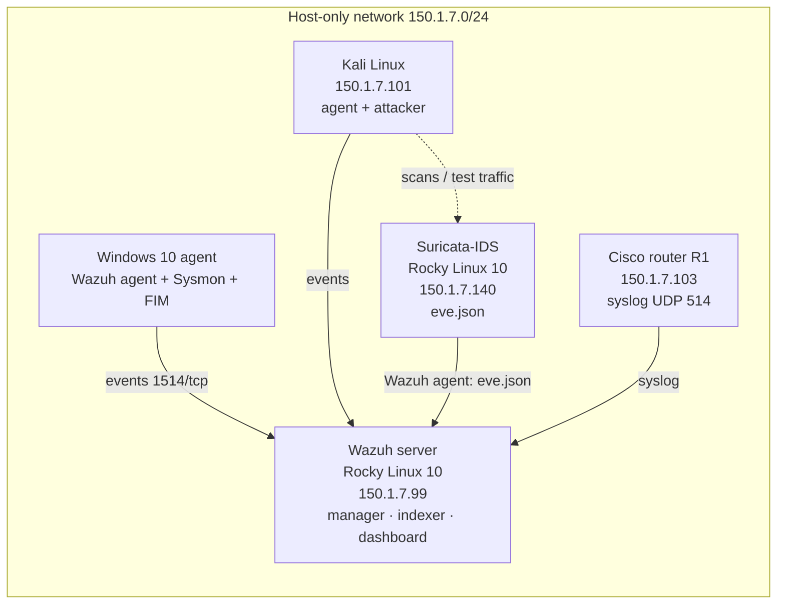

| Machine | Role | Address |
|---|---|---|
| Rocky Linux (Wazuh) | SIEM/XDR server: manager, indexer, dashboard | `150.1.7.99` |
| Windows 10 | Monitored endpoint: Wazuh agent, Sysmon, FIM | host-only `150.1.7.x` |
| Kali Linux | Attacker and monitored Linux agent | `150.1.7.101` |
| Rocky Linux (Suricata) | Network IDS, also a Wazuh agent | `150.1.7.140` |
| Cisco router (EVE-NG) | Sends syslog to Wazuh | `150.1.7.103` |

Each VM has a **NAT** adapter for internet access and a **host-only (VMnet1)** adapter for the lab network.

---

## 2. SOC concepts

| Term | Meaning |
|---|---|
| **Log** | Raw record written by a system |
| **Event** | A meaningful occurrence identified from one or more logs (e.g. a password seen in a log, access to an unauthorised file) |
| **Alert** | Triggered when an event matches a rule, threshold or detection logic. *May be a false positive* |
| **Incident** | A **confirmed** issue impacting users, systems or data |

Moving from log → event → alert → incident, **volume decreases and context increases**. A SOC analyst's job is to turn alerts into confirmed (or dismissed) incidents.

**Wazuh unifies SIEM and XDR:**

- **SIEM:** collects and correlates logs across the organisation so analysts can investigate each alert.
- **XDR:** integrates deeply with endpoints (and email/cloud) to show *how* an attacker got in and what they did. EDR covers the end device; XDR adds the wider picture.

**Components**

| Component | Job |
|---|---|
| **Agent** | Installed on each endpoint; ships logs and runs FIM/inventory |
| **Manager** ("the brain") | Decodes logs into one format, matches them against rules/signatures, generates alerts |
| **Indexer** | Storage and search for alerts |
| **Dashboard** | Web UI for search, triage and visualisation |

**Suricata vs Wazuh:** Wazuh watches what happens *inside* a host; Suricata watches network traffic *between* hosts. Together you get one dashboard and better correlation.

---

## 3. Wazuh server on Rocky Linux

### Create the VM (VMware Workstation)

| Setting | Value |
|---|---|
| OS | Rocky Linux 10 (64-bit, RPM-based) |
| RAM / CPU | 8 GB / 4 vCPU (enable VT-x/EPT) |
| Disk | 50 GB, single file |
| Adapters | NAT + custom host-only (VMnet1) |

During install, create a user and enable the root account. **Use strong passwords**, not lab defaults.

### Network

Two interfaces: `ens160` (NAT, internet) and `ens192` (static lab IP). Set `ens192` to `150.1.7.99/24`, then confirm both are up with `ifconfig`.

### Prepare and install

```bash
systemctl disable --now firewalld.service
nano /etc/selinux/config          # set SELINUX=disabled
```

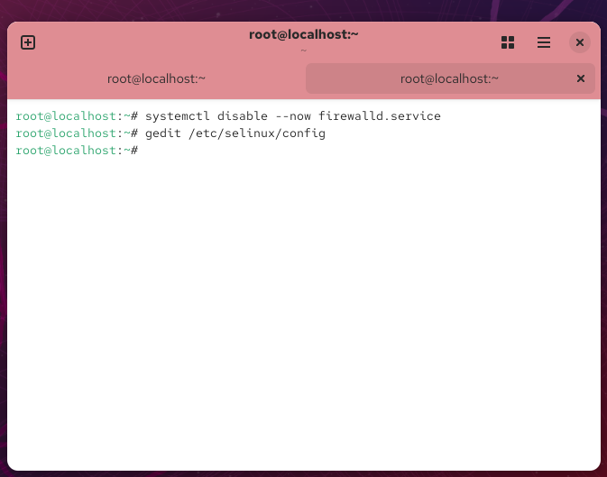
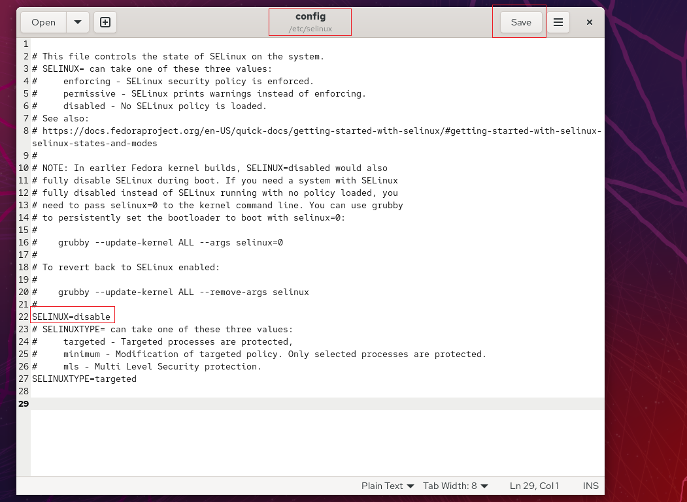
*Lab-only hardening changes the Wazuh installer expects.*

Reboot, then run the all-in-one installer (version 4.14 here):

```bash
curl -sO https://packages.wazuh.com/4.14/wazuh-install.sh && sudo bash ./wazuh-install.sh -a
```

When it finishes it prints an `admin` password once. **Save it somewhere private.** The dashboard is at `https://150.1.7.99`.

To change the admin password later:

```bash
sudo bash /usr/share/wazuh-indexer/plugins/opensearch-security/tools/wazuh-passwords-tool.sh -u admin -p '<new-strong-password>'
```

Health checks (and restarts if something misbehaves):

```bash
sudo systemctl status  wazuh-manager wazuh-dashboard wazuh-indexer
sudo systemctl restart wazuh-manager wazuh-dashboard wazuh-indexer
```

> If the dashboard says *"Wazuh dashboard server is not ready yet"*, just wait a minute.

### Manager configuration

The manager's `ossec.conf` can be edited in the dashboard: **Server management → Settings → Edit configuration**. Two changes I made:

1. Accept **syslog** from the lab network (for the router, see section 7):

```xml
<remote>
  <connection>syslog</connection>
  <port>514</port>
  <protocol>udp</protocol>
  <allowed-ips>150.1.7.0/24</allowed-ips>
</remote>
```

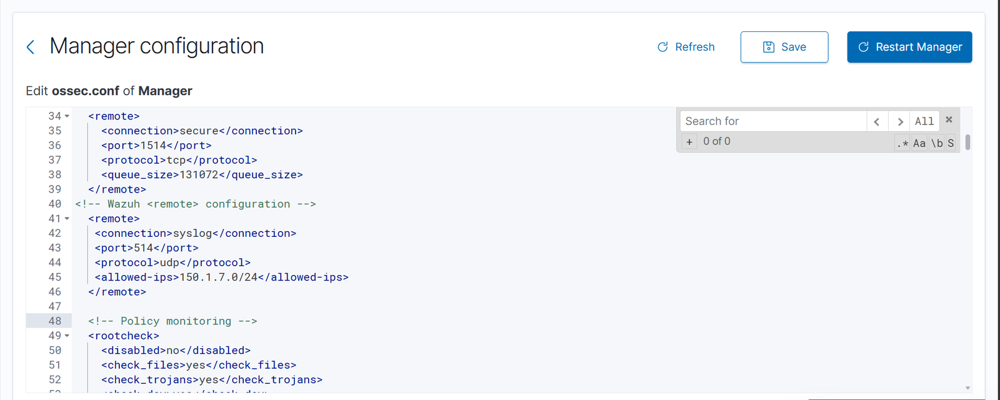

2. Archive **every** log (not only alerts), which is invaluable while building and debugging rules:

```xml
<logall>yes</logall>
<logall_json>yes</logall_json>
```

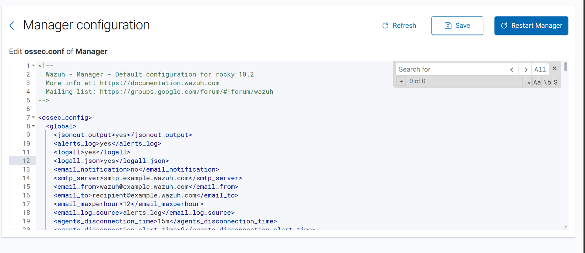

Save, then **Restart Manager**. (Turn `logall` off again in production; it is very noisy.)

---

## 4. Windows agent

In the dashboard, use **Deploy new agent → Windows**, enter the manager IP (`150.1.7.99`) and an agent name, and copy the generated command. On the Windows VM (admin PowerShell):

```powershell
Invoke-WebRequest -Uri https://packages.wazuh.com/4.x/windows/wazuh-agent-4.14.6-1.msi -OutFile $env:tmp\wazuh-agent
msiexec.exe /i $env:tmp\wazuh-agent /q WAZUH_MANAGER='150.1.7.99' WAZUH_AGENT_NAME='window10'
NET START WazuhSvc
```

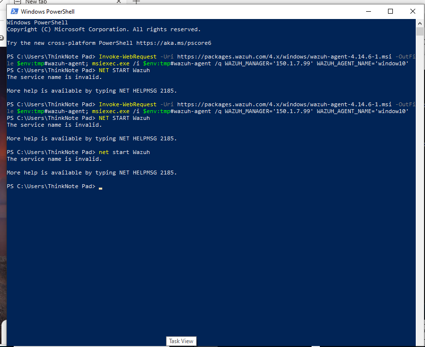
*Two problems are visible here. (1) `NET START Wazuh` fails with "The service name is invalid", because the Windows service is named **`WazuhSvc`**. (2) Look at `$env:tmp#wazuh-agent`: the `\` was typed as **`#`** because my keyboard was set to **UK English**, so the download/install path was wrong. Retype the command with a US layout. This same layout problem corrupted my FIM config later (section 6).*

If the install didn't pick up the settings, open the **Wazuh Agent** GUI (Start menu), enter the manager IP and authentication key, and press **Save** then **Refresh**.

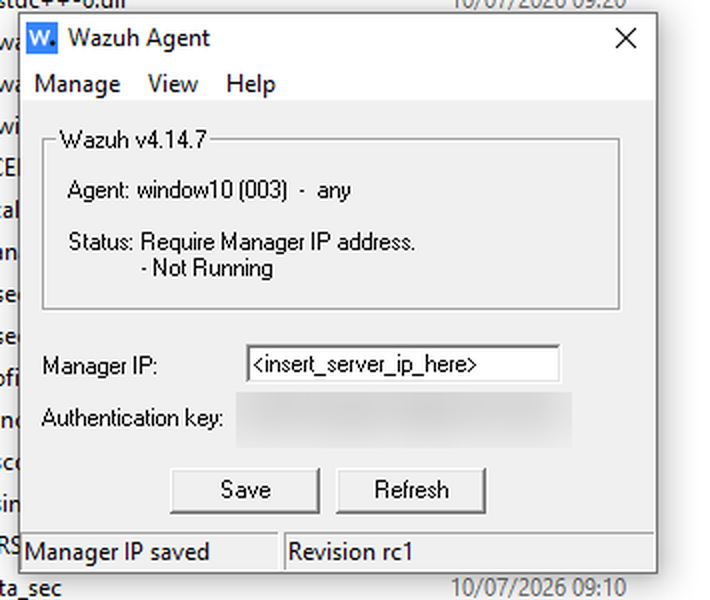
*Placeholder `<insert_server_ip_here>` and "Not Running" mean the manager IP hasn't been saved yet. (Authentication key blurred.)*

> If the lab's internet stops working, restart the **VMware NAT Service** in Windows Services.

---

## 5. Sysmon

By default the Wazuh Windows agent only ingests the standard Security, Application and System logs. **Sysmon** (Sysinternals) writes much richer telemetry into the Windows event log, which turns the agent into an "EDR-lite" sensor:

| Sysmon adds | Why it matters |
|---|---|
| Process creation with **full command line** and **parent-child** relationships | Spot suspicious chains such as Word → PowerShell |
| **Network connections** tied to the process that made them | Which program is calling out |
| File creation/modification **with hashes** | Feed hashes to reputation checks |
| **Registry** change tracking | Persistence detection |
| Driver / DLL **image loads** | Injection and side-loading |
| **LSASS access** | Credential dumping detection |

Install it with a community config (e.g. SwiftOnSecurity's `sysmon-config`):

```powershell
cd C:\Sysmon
.\Sysmon64.exe -accepteula -i sysmonconfig-export.xml
sysmon -c            # verify the loaded config
```

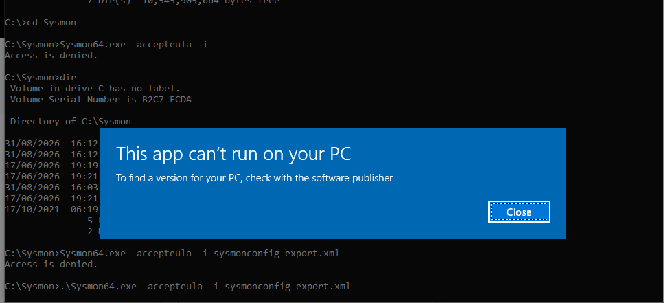
*Two classic errors. **"Access is denied"**: the prompt wasn't elevated, so run as Administrator. **"This app can't run on your PC"**: the binary doesn't match the OS architecture, so use the Sysmon build that matches your Windows (32-bit `Sysmon.exe`, 64-bit `Sysmon64.exe`).*

Tell the agent to forward the Sysmon channel. Add to the agent's `ossec.conf`:

```xml
<localfile>
  <location>Microsoft-Windows-Sysmon/Operational</location>
  <log_format>eventchannel</log_format>
</localfile>
```

> If Sysmon data doesn't appear, check the **config file name** you passed to `-i` actually matches the XML on disk.

---

## 6. File Integrity Monitoring + VirusTotal

**FIM** builds a cryptographic baseline (hashes) of critical files and alerts the moment one changes. It's also a compliance requirement for PCI DSS, HIPAA and GDPR. In Wazuh it's the `syscheck` module, which is already installed. You only configure it.

### Configure the Windows agent

Open the agent's `ossec.conf` (`C:\Program Files (x86)\ossec-agent\ossec.conf`) **in Notepad as Administrator**, find the `<syscheck>` block and:

1. Raise the event rate: `<max_eps>50</max_eps>` → `<max_eps>100</max_eps>`
2. Add the folders to watch, **above** the default directory entries:

```xml
<scan_on_start>yes</scan_on_start>
<alert_new_files>yes</alert_new_files>
<directories check_all="yes" realtime="yes" report_changes="yes" recursion_level="0">C:\Windows</directories>
<directories check_all="yes" realtime="yes" report_changes="yes">C:\Users\*\Downloads</directories>
```

Restart the agent from the Wazuh Agent GUI or `Restart-Service WazuhSvc`.

### ⚠️ The mistake that broke my agent

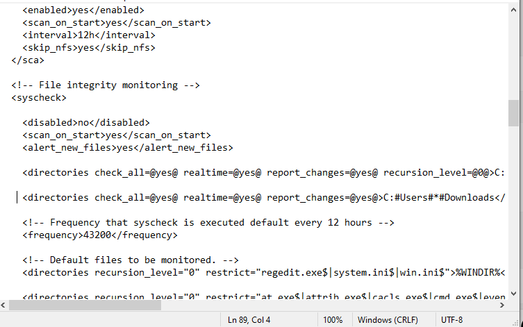
*My pasted config has `@yes@` instead of `"yes"`, `>` instead of `<`, and `#` instead of `\`.*

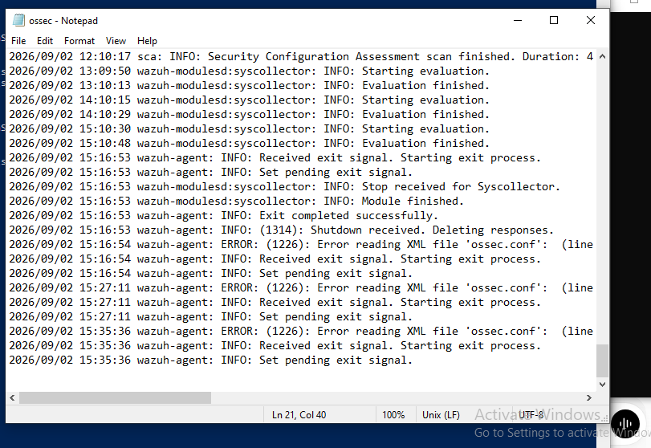
*`ossec.log`: `ERROR: (1226): Error reading XML file 'ossec.conf'`, and the agent keeps exiting.*

**Cause:** I pasted the config while the keyboard layout was **UK English**, and quotes/symbols were mangled. XML with a single bad character stops the whole agent.
**Fix:** switch the keyboard to **US English**, retype or repaste the block, then check `ossec.log` for a clean start. Always read `ossec.log` after editing.

### Add VirusTotal (automatic hash reputation)

Idea: FIM detects a new or changed file → Wazuh sends its hash to **VirusTotal** → the result lands in the alert.

1. Create a free VirusTotal account and copy the **API key**.
2. On the manager, edit `ossec.conf` (dashboard: *Server management → Settings → Edit configuration*) and add before the closing tag:

```xml
<integration>
  <name>virustotal</name>
  <api_key>YOUR_VIRUSTOTAL_API_KEY</api_key>
  <group>syscheck</group>
  <alert_format>json</alert_format>
</integration>
```

3. Save, restart the manager, and confirm with `sudo systemctl status wazuh-manager`.

> **Never publish your API key.** Keep it out of screenshots and Git commits.

### Test it with EICAR

On the isolated Windows VM, temporarily turn off Defender real-time protection and add an exclusion for the Downloads folder, then download the harmless **EICAR** test file. Expected result: an FIM alert for the new file, followed by a VirusTotal enrichment alert. Turn Defender back on afterwards.

---

## 7. Network device logs (Cisco syslog)

Why send router logs to Wazuh: centralised logging, real-time monitoring, alerting/correlation and visualisation, with `router → Wazuh log collector → dashboard`.

**Router (R1):**

```
hostname R1
interface FastEthernet0/0
 ip address 150.1.7.103 255.255.255.0
 no shutdown
ip route 0.0.0.0 0.0.0.0 150.1.7.100
!
logging host 150.1.7.99 transport udp port 514
logging trap informational
service timestamps log datetime msec
process cpu threshold type total rising 80 interval 5 falling 70 interval 5
```

- `logging host …` forwards syslog over UDP 514 to the Wazuh manager
- `logging trap informational` sets severity to informational and above (there are 7 levels)
- `service timestamps … msec` adds millisecond timestamps to every message

**Manager:** the `<remote>` syslog block and `logall` from [section 3](#manager-configuration).

**Verify that the manager is listening / receiving:**

```bash
tcpdump -ni any udp port 514
```

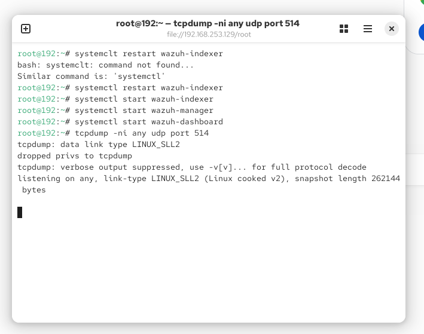

To generate events: shut/no-shut a router interface, or run `hping3 -1 <router-ip>` from Kali, then search the dashboard for the router's address.

---

## 8. Suricata IDS on its own VM

**IDS** detects intrusions; **IPS** detects *and* blocks. Here Suricata runs as an IDS on a dedicated Rocky Linux VM and writes alerts as JSON (`eve.json`), which the Wazuh agent forwards to the manager.

> **Version compatibility matters:** the Suricata version must work with your Wazuh version.

### 8.1 Clone the VM (and fix the VMware version error)

I cloned a Rocky VM and VMware refused to open it:

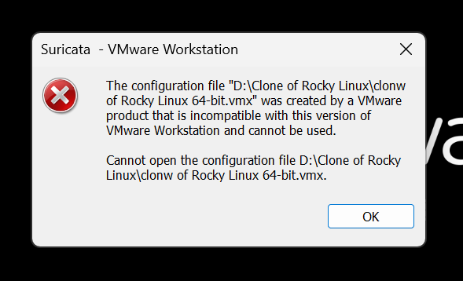
*"The configuration file … was created by a VMware product that is incompatible with this version of VMware Workstation."*

**Fix:** open the clone's `.vmx` file in a text editor and set the hardware version to match your Workstation (mine is 17.6):

```
virtualHW.version = "17"
```

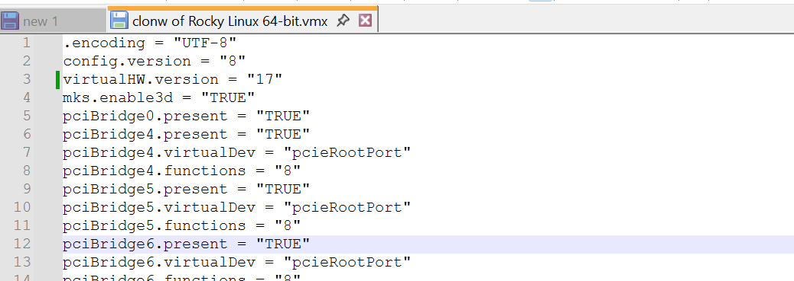

When VMware asks if the VM was *moved* or *copied*, choose **I Copied It** so it gets a new MAC address.

For a fresh VM I used the **Rocky Linux 10.2 minimal** ISO:

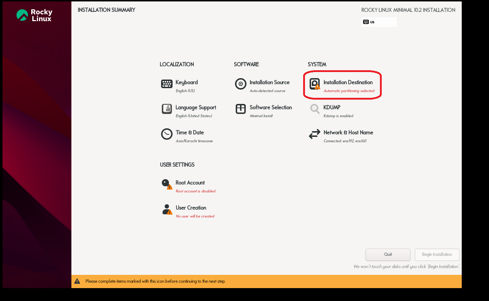

### 8.2 Give it a static lab IP

```bash
nmcli connection show
nmcli connection modify ens192 ipv4.addresses 150.1.7.140/24
nmcli connection modify ens192 ipv4.gateway 150.1.7.100
nmcli connection modify ens192 ipv4.dns 8.8.8.8
nmcli connection modify ens192 ipv4.method manual
nmcli connection down ens192 && nmcli connection up ens192
ip addr show ens192
```

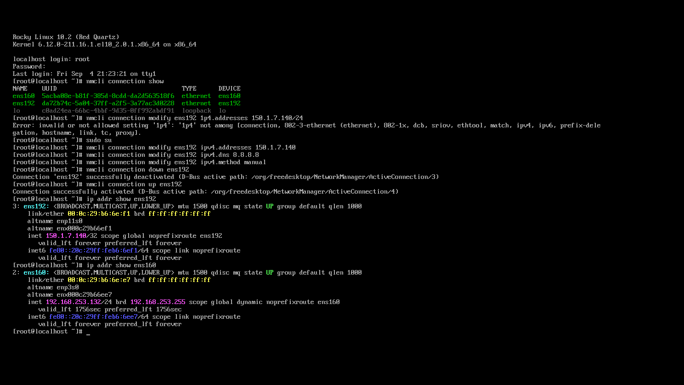
*My first command had a typo (`1p4.addresses` instead of `ipv4.addresses`), and when I re-ran it I dropped the `/24`.*

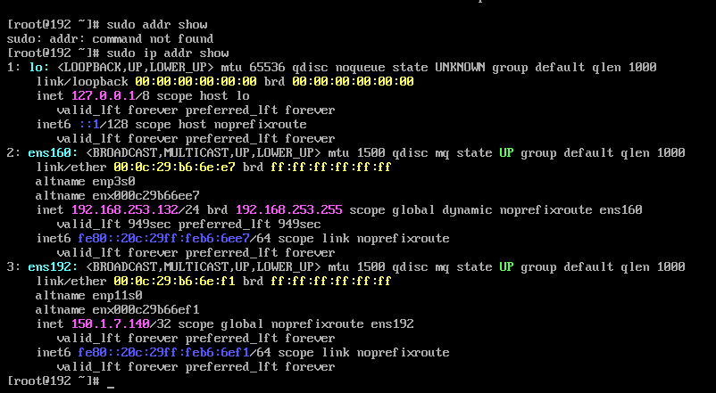
*⚠️ Look closely: `ens192` shows **`150.1.7.140/32`**. I left off the **`/24`** prefix, so the interface got a /32 mask. Always include the prefix length.*

### 8.3 Install Suricata 8 and the rules

```bash
sudo dnf install 'dnf-command(copr)'
sudo dnf copr enable @oisf/suricata-8.0
sudo dnf install epel-release
sudo dnf install suricata
mkdir -p /etc/suricata/rules
```

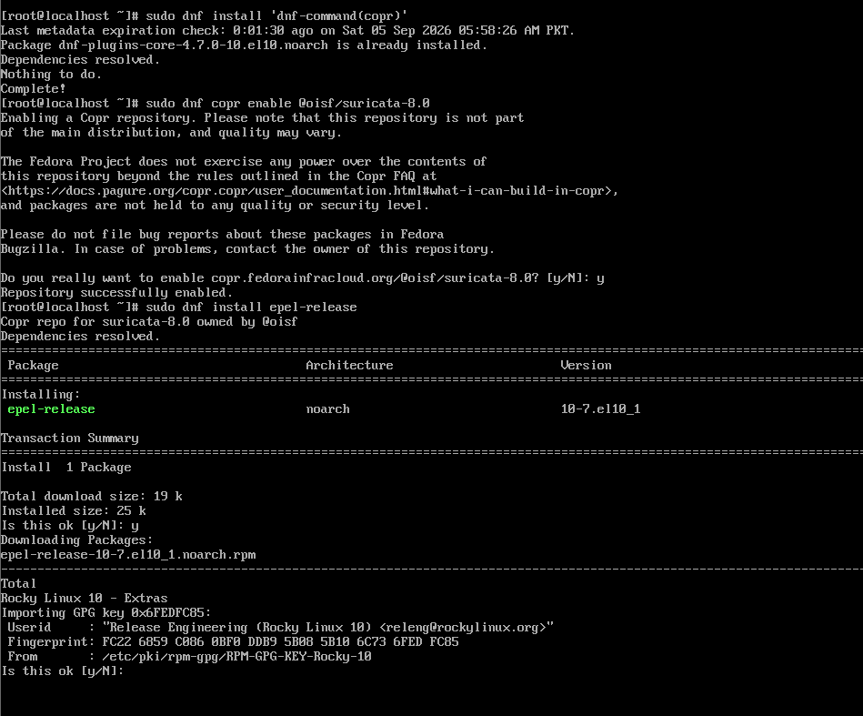
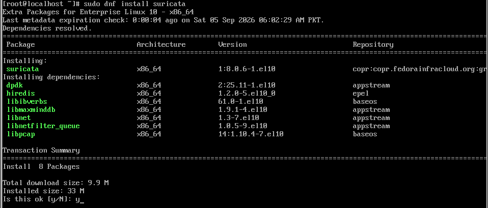
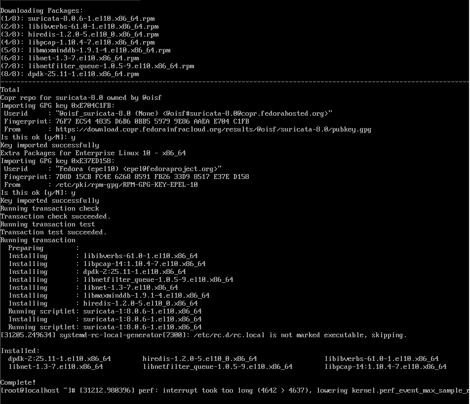

Download the **Emerging Threats Open** rules and install them (use the folder that matches your Suricata version):

```bash
cd /tmp && curl -LO https://rules.emergingthreats.net/open/suricata-8.0.6/emerging.rules.tar.gz
sudo dnf install tar
sudo tar -xvzf emerging.rules.tar.gz && sudo mv rules/*.rules /etc/suricata/rules/
sudo chown -R suricata:suricata /etc/suricata/rules/*
sudo chmod 640 /etc/suricata/rules/*.rules
```

### 8.4 Configure `suricata.yaml`

```bash
gedit /etc/suricata/suricata.yaml    # or nano
```

| Setting | Value | Why |
|---|---|---|
| `HOME_NET` | `"[150.1.7.0/24]"` | The network to protect |
| `EXTERNAL_NET` | `"any"` | Everything else |
| `default-rule-path` | `/etc/suricata/rules` | Where rules live |
| `rule-files` | `- "*.rules"` | Load all rule files |
| `af-packet` → `interface` | `ens192` | The capture NIC (default `eth0` doesn't exist here) |

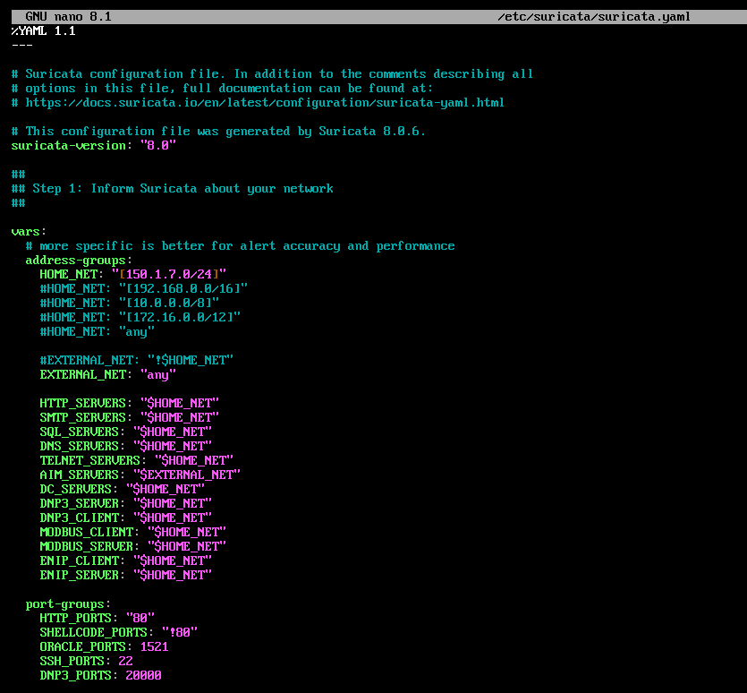

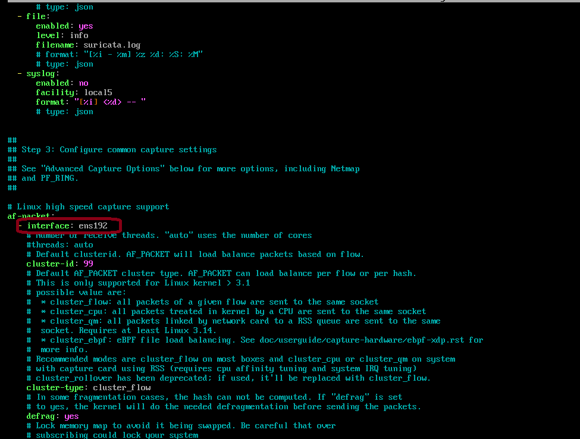
*The `af-packet` interface changed to `ens192`.*

Also tell the service which interface to listen on in `/etc/sysconfig/suricata`:

```
OPTIONS="-i ens192 --user suricata"
```

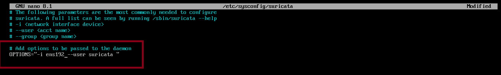

Then:

```bash
sudo systemctl restart suricata
sudo systemctl status suricata
sudo systemctl enable suricata      # persistent across reboots
```

### ⚠️ Service failed to start

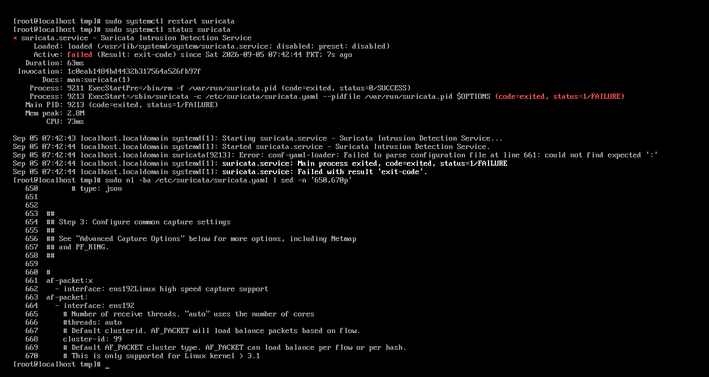
*`Active: failed (Result: exit-code)`. Suricata couldn't parse its config: *"could not find expected ':'"* near line 661. Printing that area (`sed -n '650,670p' suricata.yaml`) showed `- interface: ens192Linux high speed capture support`, where my edit had glued the next comment onto the interface line.*

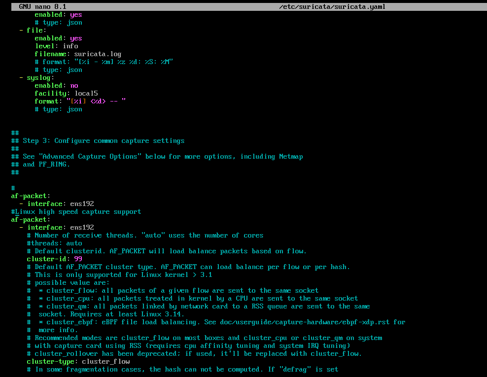

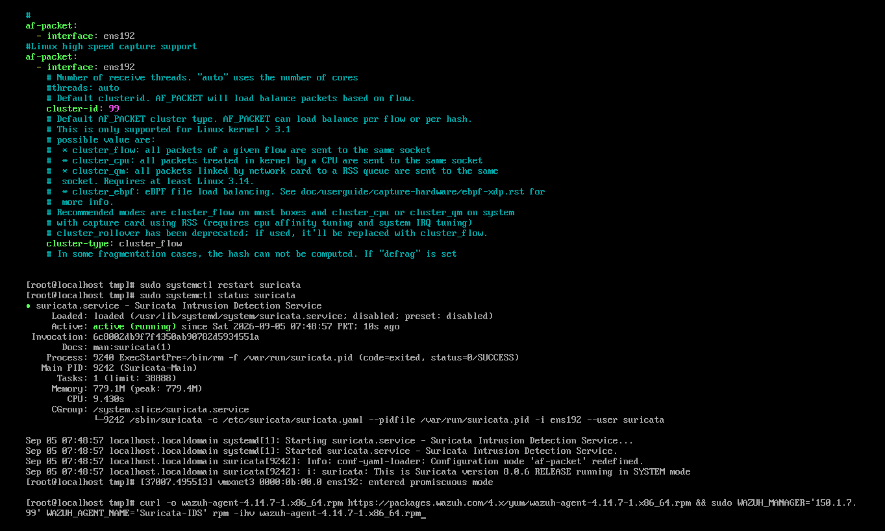
*After the fix: `Active: running`, and the kernel log shows `ens192: entered promiscuous mode`.*

**Lesson:** YAML is whitespace and newline sensitive. After any edit, run `sudo suricata -T -c /etc/suricata/suricata.yaml` to test the config before restarting.

### 8.5 Make the Suricata VM a Wazuh agent

In the dashboard: **Deploy new agent → Linux → RPM amd64**, server `150.1.7.99`, agent name `Suricata-IDS`.

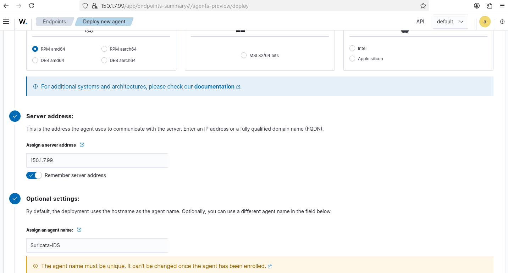

Run the generated commands on the Suricata VM:

```bash
curl -o wazuh-agent-4.14.7-1.x86_64.rpm https://packages.wazuh.com/4.x/yum/wazuh-agent-4.14.7-1.x86_64.rpm \
  && sudo WAZUH_MANAGER='150.1.7.99' WAZUH_AGENT_NAME='Suricata-IDS' rpm -ihv wazuh-agent-4.14.7-1.x86_64.rpm
sudo systemctl daemon-reload
sudo systemctl enable wazuh-agent
sudo systemctl start wazuh-agent
```

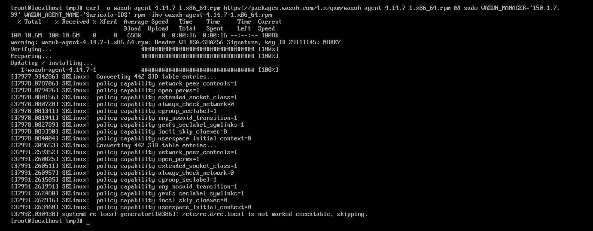
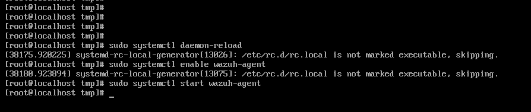

The agent list in the dashboard now shows **Suricata-IDS (004) active** alongside my Kali and Windows agents:

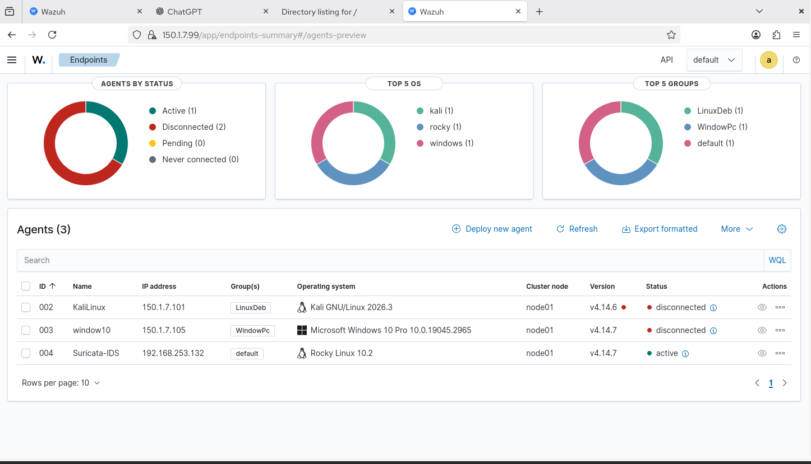
*3 agents: KaliLinux (150.1.7.101), window10, and Suricata-IDS, which is active. (The other two were powered off at the time, hence "disconnected".)*

---

## 9. Wire Suricata into Wazuh

Goal: a working **SIEM → IDS pipeline** where Suricata's alerts become actionable events in Wazuh.

### 9.1 Let the VM sniff traffic (promiscuous mode)

In VMware, power the Suricata VM **off**, edit its `.vmx`, and add:

```
ethernet0.noPromisc = "FALSE"
ethernet1.noPromisc = "FALSE"
```

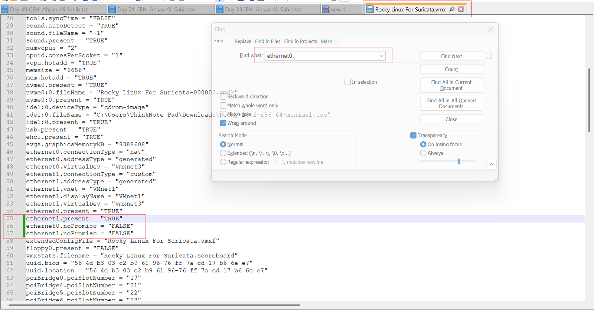

Power on and restart Suricata. The kernel log should show the NIC entering promiscuous mode:

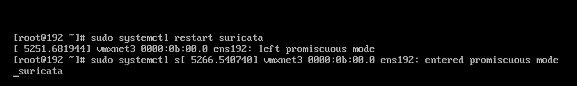

### 9.2 Tell the Wazuh agent to read `eve.json`

Suricata writes alerts in JSON to `/var/log/suricata/eve.json`. On the Suricata VM edit the agent config (`gedit /var/ossec/etc/ossec.conf`) and add this inside `<ossec_config>`:

```xml
<localfile>
  <log_format>json</log_format>
  <location>/var/log/suricata/eve.json</location>
</localfile>
```

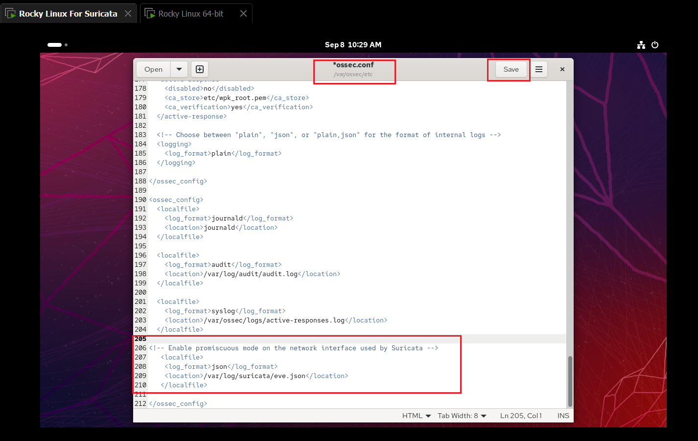
*The new `<localfile>` block (near line 206) is highlighted.*

```bash
systemctl restart wazuh-agent
```

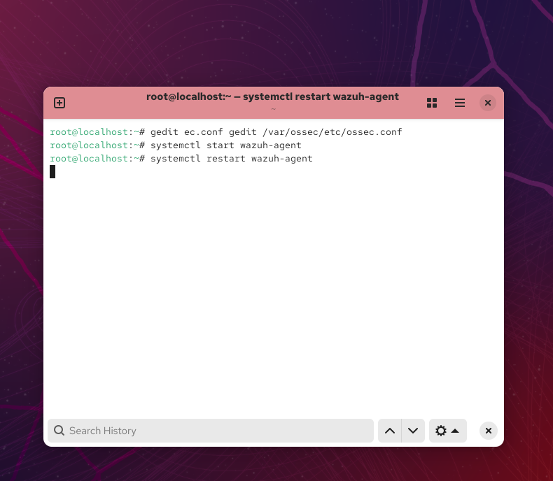

If your host's networking drops, restart the **VMware NAT Service** and **VMware DHCP Service** in Windows Services:

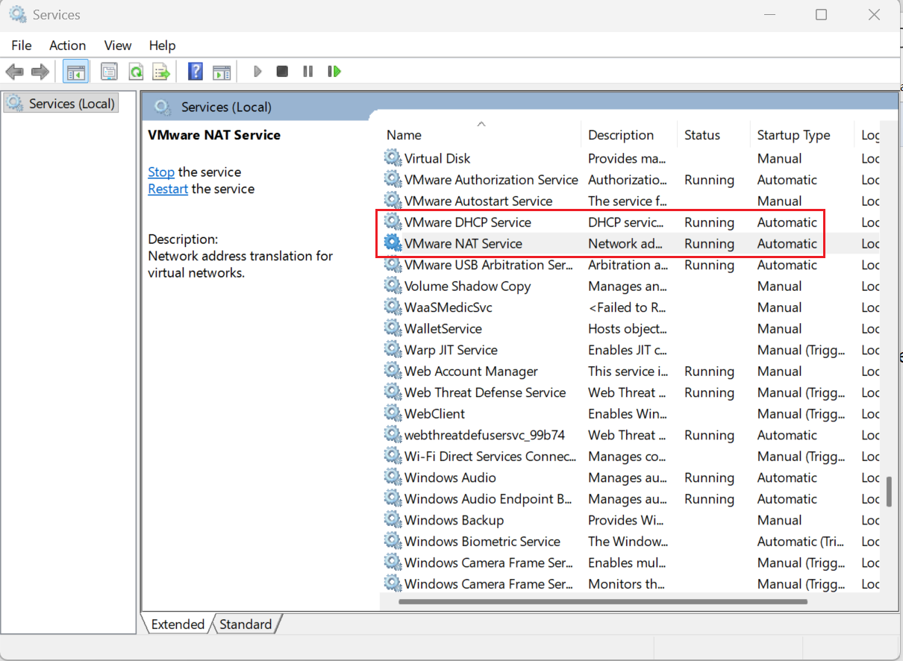

### 9.3 Find it in the dashboard

Open **Endpoints → Suricata-IDS → More → Threat Hunting**:

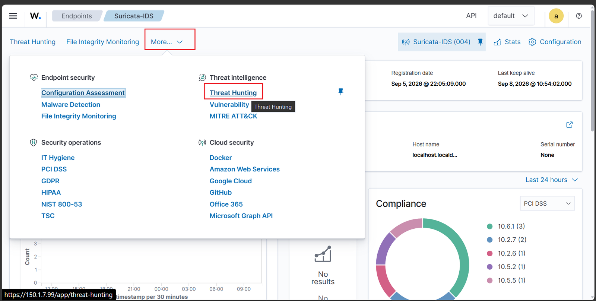
*Threat Hunting sits under *Threat intelligence*; the same menu offers compliance modules such as PCI DSS, HIPAA, GDPR and NIST 800-53.*

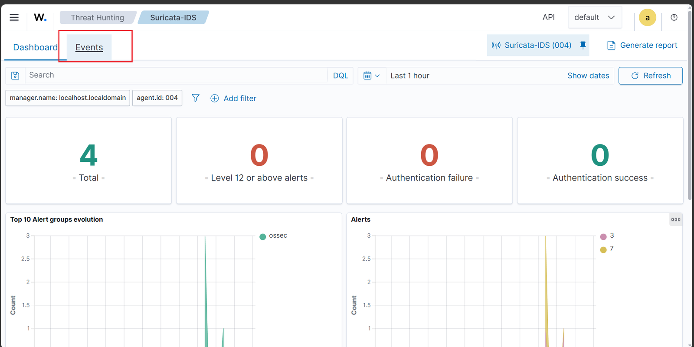
*The **Events** tab filtered to the Suricata-IDS agent.*

Wazuh already ships a decoder and rules for Suricata's JSON, so no custom decoder is needed.

---

## 10. Generate traffic and validate

From **Kali** (the attacker), confirm connectivity and scan the Suricata VM:

```bash
ping 150.1.7.140
nmap -sS -Pn 150.1.7.140          # TCP SYN scan
nmap -sn 150.1.7.140/24           # ping sweep of the lab subnet
```

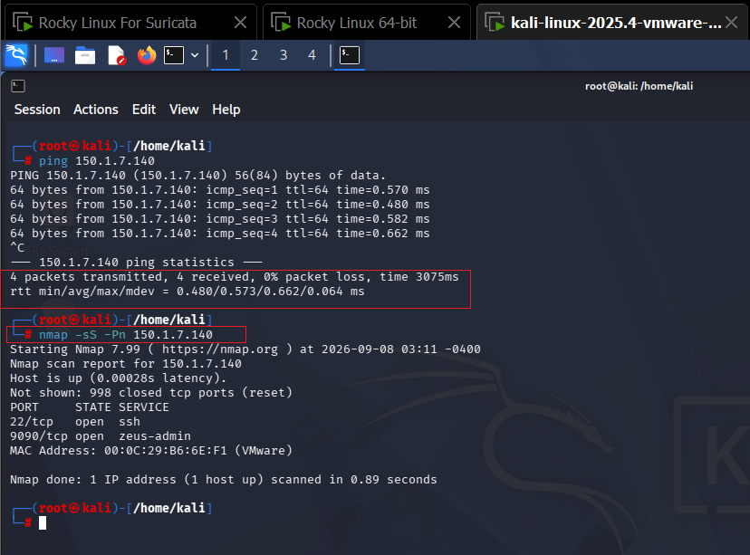
*0% packet loss; the SYN scan finds only `22/tcp` (SSH) and `9090/tcp` open, with the other 998 ports closed.*

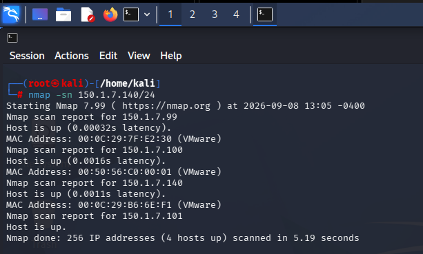
*Sweep of `150.1.7.0/24`: 4 hosts up: the Wazuh server (.99), gateway (.100), Kali (.101) and the Suricata VM (.140).*

In the dashboard set the time range to **Last 1 hour** and **auto-refresh every 1 second**, then scan again, so new events appear as they land:

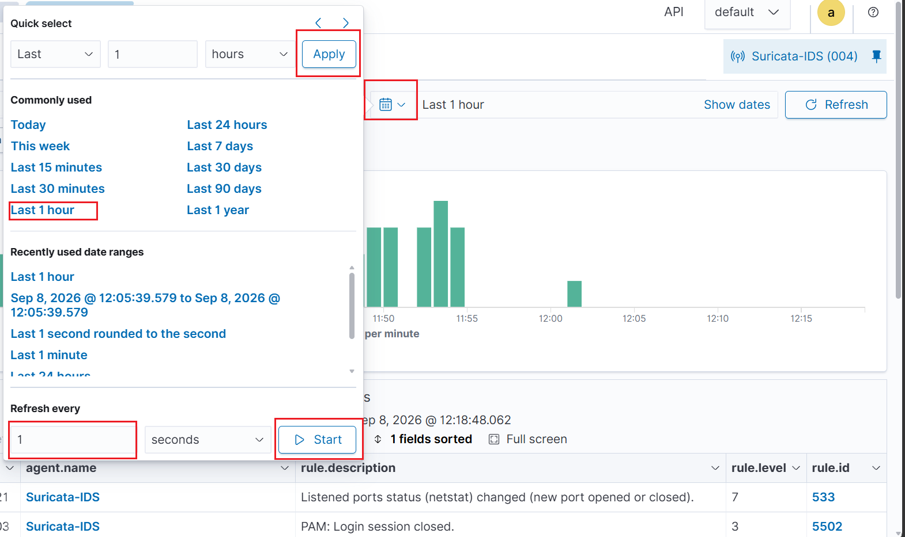

> **If you don't see Suricata logs:** power off Suricata and the Wazuh server, re-check the `localfile` block, restart the agent, run the scan again, and only then look under Threat Hunting. See [section 13](#13-troubleshooting-cheat-sheet).

---

## 11. Custom Suricata rules

The default Emerging Threats rules are in `/etc/suricata/rules/` (Snort-compatible format). To detect a specific attack I write my own in **`local.rules`**.

### Rule anatomy

```
alert udp any any -> $HOME_NET any (msg:"…"; threshold:…; sid:1000001; rev:1;)
└─header: action, protocol, src/dst, ports─┘└──────── body: options ───────────┘
```

The **header** defines the action, protocol, addresses and ports; the **body** adds the message, match conditions, thresholds and a unique `sid`.

### Rules I wrote

```
# Slowloris: many new connections to the web port from one source
alert tcp any any -> $HOME_NET 80 (msg:"SLOWLORIS High Connection Rate to HTTP Port"; \
  flow:to_server; flags:S; \
  threshold:type threshold, track by_src, count 20, seconds 10; \
  sid:1000011; rev:2;)

# UDP flood: >100 UDP packets in 5 s from one source
alert udp any any -> $HOME_NET any (msg:"UDP Flood Detected - Possible DoS"; \
  threshold:type both, track by_src, count 100, seconds 5; \
  classtype:attempted-dos; sid:1000001; rev:1;)

# DHCP starvation: very high rate of DHCP Discover from clients
alert udp any 68 -> any 67 (msg:"POSSIBLE DHCP Starvation Attack Detected (High Request Rate)"; \
  content:"|01|"; depth:1; \
  threshold:type threshold, track by_src, count 50, seconds 5; \
  sid:2000001; rev:1;)
```

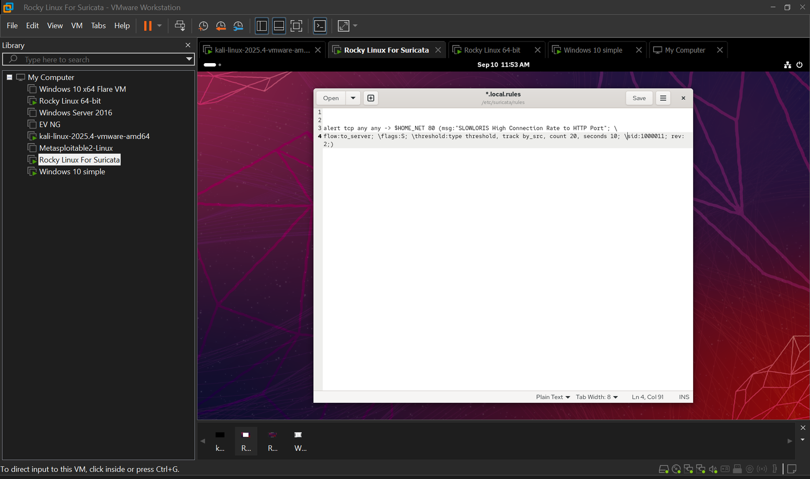

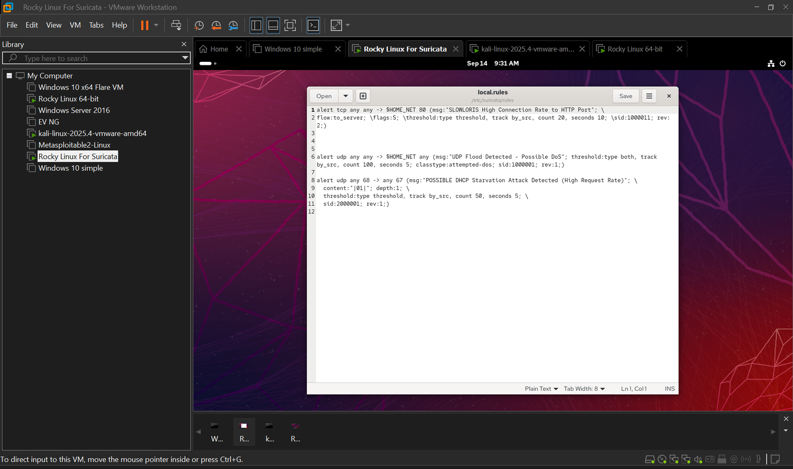

### Enable the file and reload

Add `local.rules` to `rule-files` in `suricata.yaml`:

```yaml
default-rule-path: /etc/suricata/rules
rule-files:
  - "*.rules"
  - local.rules
```

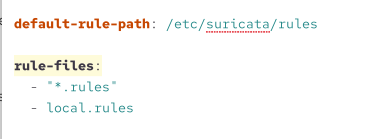

```bash
sudo systemctl daemon-reload
sudo systemctl restart suricata
sudo systemctl status suricata     # confirms the rule file has no errors
```

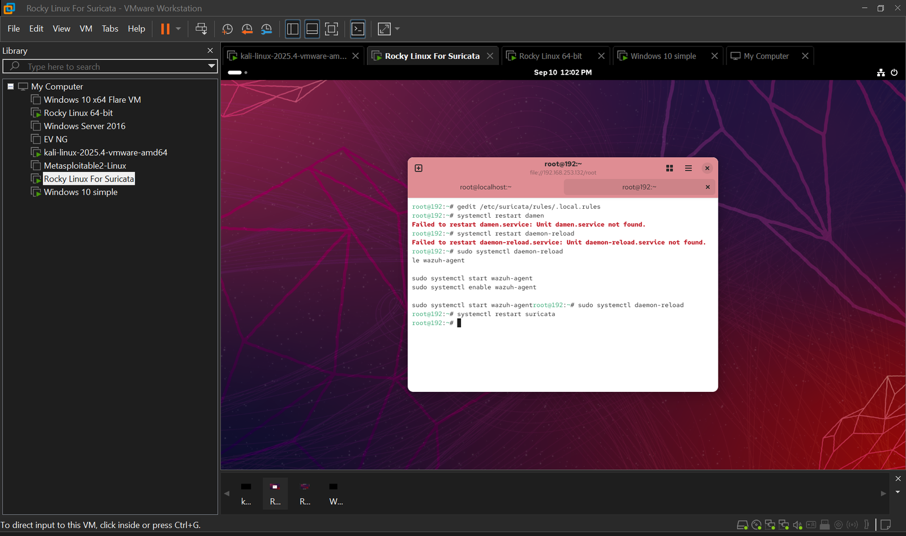
*I typed `systemctl restart daemon-reload` by mistake ("Unit daemon.service not found"). The correct pair is `systemctl daemon-reload`, then `systemctl restart suricata`.*

### Make sure Wazuh doesn't drop the events

If you don't receive Suricata logs during heavy test traffic, raise the agent's event buffer in the Suricata VM's `ossec.conf`:

```xml
<client_buffer>
  <disabled>no</disabled>
  <queue_size>100000</queue_size>
  <events_per_second>5000</events_per_second>
</client_buffer>
```

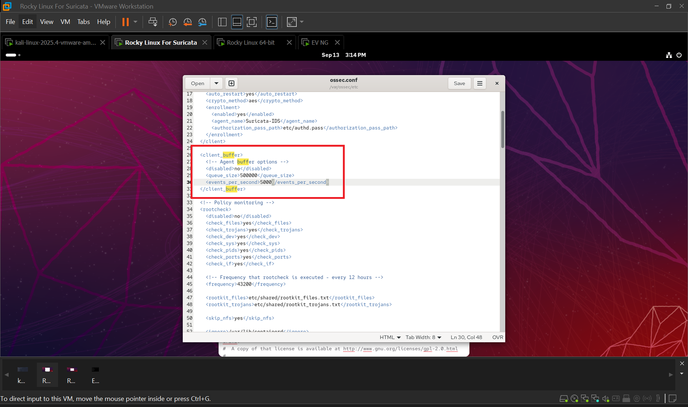

### Test your signatures (lab only)

Run the matching test from Kali against a **lab target you own**, then confirm the alert in Wazuh:

| Rule | Lab test from Kali | Look for |
|---|---|---|
| Ping of death / oversize ICMP | `ping -M want -s 65500 <target>` | ICMP alert from the Suricata agent |
| UDP flood | `hping3 --flood -p 445 --udp <target>` | `UDP Flood Detected - Possible DoS` |
| Slowloris | a slow-HTTP test tool against the web port | `SLOWLORIS High Connection Rate…` |
| DHCP starvation | a DHCP-starvation tool on the lab segment | `POSSIBLE DHCP Starvation Attack…` |

Defence idea: **signature build-up**. Every attack has a signature, so add a rule for each technique you've seen.

<!-- TODO: add screenshots of the custom-rule alerts firing in the Wazuh dashboard (rule.description, agent.name = Suricata-IDS) and embed them here -->

---

## 12. Alert triage workflow

How I work an alert in the dashboard:

1. **Scope:** pick the agent and time range (*Last 1 hour*), turn on auto-refresh while testing.
2. **Sort by severity:** `rule.level` (the Wazuh scale is 0–15; 12+ is high priority).
3. **Read the rule:** `rule.id` and `rule.description` tell you *what* matched.
4. **Pivot:** filter by `agent.name`, source IP, or `rule.groups` to see related events.
5. **Decide:** *false positive* (expected activity), *true positive* (investigate and escalate), or *needs more data*.
6. **Escalate:** a confirmed, impactful alert becomes an **incident**.

### Worked example from my lab

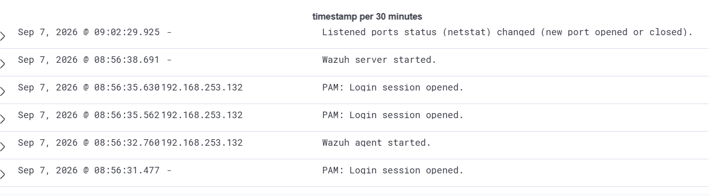
*On the Suricata VM: "Wazuh agent started", "PAM: Login session opened" and **"Listened ports status (netstat) changed (new port opened or closed)"**.*

| Event | Rule | Level | Assessment |
|---|---|---|---|
| `Listened ports status (netstat) changed` | 533 | 7 | Medium. A new port opening is expected right after I started a service, but in production I'd verify against a change ticket |
| `PAM: Login session opened/closed` | 5501 / 5502 | 3 | Low. Normal SSH/console login activity, but a burst from an unknown IP would matter |

In a real SOC the same logic applies: ask *"is this expected for this host, at this time, from this user?"* before escalating.

---

## 13. Troubleshooting cheat sheet

| Symptom | Likely cause | Fix |
|---|---|---|
| `NET START Wazuh` → "service name is invalid" | Wrong service name, or install command mangled by keyboard layout (`#` for `\`) | `NET START WazuhSvc`; retype the install command on a US layout |
| Agent exits; `ossec.log`: *Error reading XML file* | Corrupted config (wrong keyboard layout / bad paste) | Switch to US keyboard, retype the block |
| Agent stays "Not Running" | Manager IP/key not saved | Enter in the Wazuh Agent GUI → **Save**, **Refresh** |
| Sysmon "Access is denied" | Not elevated | Run as Administrator |
| Sysmon "This app can't run on your PC" | Wrong CPU-architecture build | Use the matching Sysmon binary |
| Sysmon events missing | Config filename typo / channel not forwarded | Check `-i` filename, add the `localfile` channel |
| VMware: "configuration file … incompatible" | Hardware version too new | Edit `.vmx` → `virtualHW.version` |
| Suricata `failed (exit-code)` | YAML syntax error | `sudo suricata -T -c /etc/suricata/suricata.yaml`, fix the line |
| Interface has `/32` | Missed `/24` in `nmcli` | Re-run with `150.1.7.140/24` |
| No Suricata logs in Wazuh | NIC not promiscuous / `localfile` missing / buffer too small | `noPromisc = "FALSE"`, add `eve.json` block, raise `client_buffer`, restart agent |
| Lab VMs lose internet | VMware NAT service stopped | Restart **VMware NAT Service** |
| Dashboard "server is not ready yet" | Services still starting | Wait; check `systemctl status wazuh-*` |

---

## 14. Lessons learned

- **One wrong character can silence an agent.** Always read `ossec.log` after editing configuration.
- **Layers see different things:** host telemetry (Sysmon/FIM) and network detection (Suricata) catch different parts of an attack, and together they correlate.
- **Detection needs tuning.** Thresholds (count/seconds) decide between catching a flood and drowning in false positives.
- **Validate end-to-end.** A rule isn't "done" until the attack from Kali produces a visible alert in the dashboard.
- **Protect secrets.** API keys, agent keys and admin passwords never belong in screenshots or repos.
- **Never copy lab shortcuts into production** (disabled firewall/SELinux/Defender, `logall`, default passwords).

---

*Built in an isolated virtual lab for learning and portfolio purposes.*

[Browse more of my work on GitHub ↗](https://github.com/UsamaAhmad360?tab=repositories)
